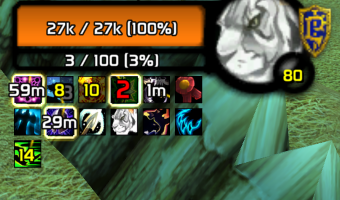

# DispelGlow

[](https://github.com/zxxdev/DispelGlow/actions/workflows/ci.yml)
[](LICENSE)

Makes the Magic buffs on your enemy target and focus glow when you can purge or dispel them. For the **World of Warcraft 3.3.5a** client (Wrath of the Lich King).

<p align="center">
  
  <br><sub>Magic buffs your character can remove glow; the others do not.</sub>
</p>

## Why it exists

In arenas and battlegrounds, purging the right buff at the right time wins fights, but the default target frame shows every buff the same way. A mage gets a glowing border on the buffs Spellsteal can take; the other classes that can remove Magic from an enemy get nothing. DispelGlow gives them the same border, using the texture Blizzard already draws for Spellsteal.

## What it does

The glow appears only if your character has one of these spells:

| Class | Spell |
|---|---|
| Shaman | Purge |
| Priest | Dispel Magic, Mass Dispel |
| Hunter | Tranquilizing Shot |
| Warrior | Shield Slam |
| Warlock | Devour Magic, while the Felhunter is out |
| Mage | Nothing to add: Spellsteal already has the game's own glow |

- Only **enemies**: a friendly target or focus never glows.
- Only **Magic** buffs: the ones these spells can remove.
- A character too low to have the spell sees nothing until it is learned. After a respec or a dual spec swap, it looks again.
- Spell names are read from the game, so it works with any client language.

## Limitations

- Only the target and focus frames of the game's own interface. Party, arena and other unit frame addons are not covered.
- It shows what *can* be removed, not what is worth removing.
- It does not check range, cooldown, mana or rage, or (for Shield Slam) whether a shield is equipped.
- Tranquilizing Shot also removes Enrage effects; only Magic buffs glow.

## Install

1. Download this repository (**Code → Download ZIP**) and unzip it.
2. Make a folder called `DispelGlow` inside `World of Warcraft/Interface/AddOns/`.
3. Copy `DispelGlow.toc` and `DispelGlow.lua` into it. Nothing else is needed.
4. Start the game and check that **DispelGlow** is enabled in the AddOns list on the character screen.

A ready-to-copy zip will be attached to the v1.0.0 release.

## Usage

There is nothing to set up. Type `/dglow` (or `/dispelglow`) to see whether the glow is on. It answers with one of:

```text
DispelGlow: on, with Shield Slam.
DispelGlow: off until the spell is learned (or, for a warlock, the Felhunter is out).
DispelGlow: off. This class has no spell that removes Magic from an enemy.
DispelGlow: nothing to add, Spellsteal already has the game's own glow.
```

## How it works

- **No game function is replaced.** The addon runs after Blizzard's `TargetFrame_UpdateAuras` (with `hooksecurefunc`) and shows the glow texture that the frame already has for each buff. Blizzard hides it again on its next redraw, so nothing is left behind.
- **The spell is found by name in the spell book.** The names come from the spell IDs of the first rank (`GetSpellInfo`), so every rank and every language matches. For a warlock it looks in the pet's spell book, and follows the pet when it is summoned or dismissed.
- **Light on the game.** A class that cannot remove Magic hooks nothing and listens to nothing. The others stop looking once the spell is found, until the talents change. Each glow texture is looked up once and kept, so redrawing the buffs creates no new strings or tables. Nothing global except the slash command.
- **Privacy.** It saves nothing (no saved variables) and reads only the spell book, the pet's spell book and the buffs of your target and focus.

## Development

You need Lua 5.1, [busted](https://lunarmodules.github.io/busted/) and [luacheck](https://github.com/lunarmodules/luacheck). From the repository root:

```sh
luacheck .   # lint
busted       # tests
```

Files:

```text
DispelGlow.toc          what the game loads
DispelGlow.lua          the whole addon
spec/                   tests
.luacheckrc             lint settings and the game API the addon uses
```

### Quality

- **Tests** (busted): the game is played by plain Lua tables in [`spec/dispelglow_spec.lua`](spec/dispelglow_spec.lua). They cover each class, the warlock's pet, enemies against friends, Magic against other buffs, respecs, and that classes without a spell hook nothing.
- **Lint** (luacheck): with the list of game functions the addon reads, so a misspelt or accidental global fails the build.
- Both run in [CI](.github/workflows/ci.yml) on every pull request. They test the addon's logic against a fake game, not the game itself; it has been checked in the game with a warrior.

## History

DispelGlow started as a small personal addon called `a`. The [first commit](https://github.com/zxxdev/DispelGlow/commit/e09eff7) is that version, exactly as it ran in the game folder. Version 1.0.0 is the cleaned-up version for publishing: see the [changelog](CHANGELOG.md).

## License

[MIT](LICENSE). World of Warcraft is a trademark of Blizzard Entertainment; this addon is not affiliated with or endorsed by Blizzard.
